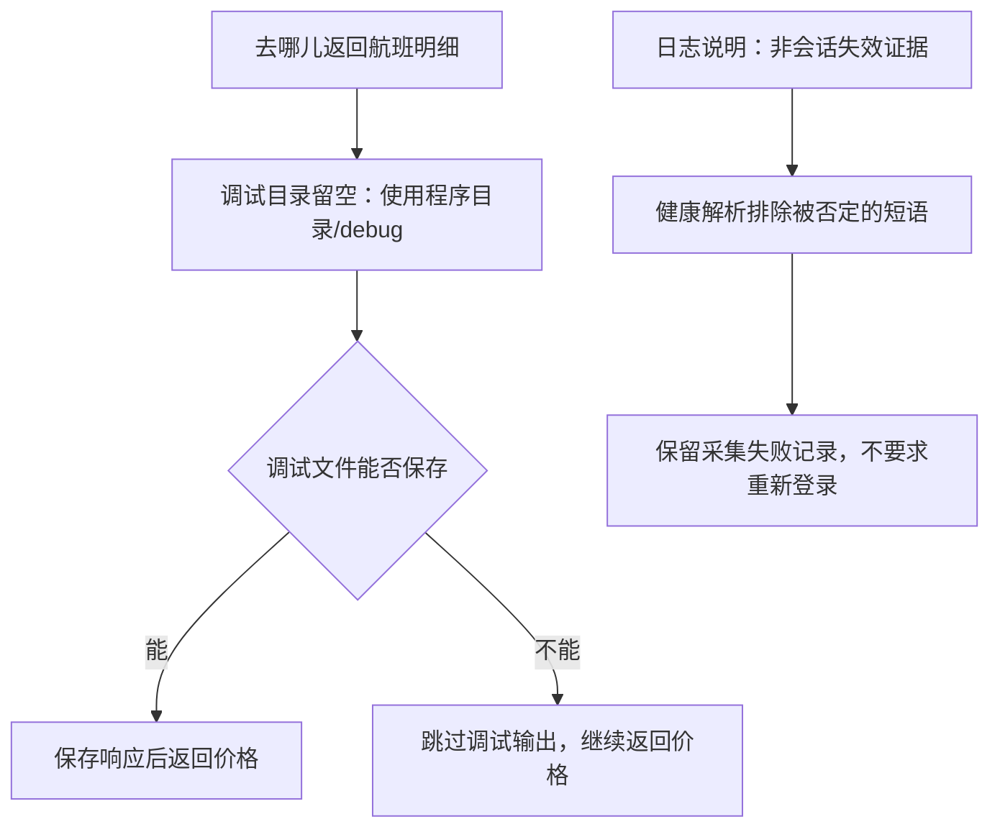

# macOS 渠道取数与登录状态修复 · Apple Silicon

2026-11-05，基于 1.5.307 的 macOS 修复构建，发布标签 `v1.5.307-macos-channel-fix`。
程序的 `--version` 仍输出 `1.5.307`；具体构建标记、源码提交和 SHA256 见包内 `BUILD_INFO.json`。

## 本次修复

- **去哪儿有航班却采集为零**：开启调试但将目录留空时，保存原始响应会抛出 `FileNotFoundError`，已经解析到的航班随之丢弃。现在留空使用程序目录下的 `debug`，相对路径也按程序目录解析；调试目录无法创建或写入时，继续返回价格。携程和途牛的同类调试写入也做了异常隔离。
- **控制台误报会话失效**：健康解析曾把日志中的“非会话失效证据”“不判会话失效”“清除旧失效证据”当作认证失败。现在忽略被否定的短语，仍识别“请登录”等独立的认证失败证据。历史日志重新解析后即可消除这类误报，无需删除记录或重新登录。
- **途牛 PC/H5 同名 Cookie 冲突**：`mtoken`、`udid`、`_taca` 等 Cookie 在多个域下共存时，按接口域名和路径选取，避免 `CookieConflict`。连接异常按 `error` 记录，不再沿用历史登录失败标记。这不会取消渠道自身的滑块或登录要求。
- **后台启停入口**：正常启动后可关闭终端和浏览器，使用四个 `.command` 入口启动、停止、重启和查看状态；默认不设置登录 Mac 时自动启动。保留此前的 macOS 原生登录窗口修复，以及打包后登录与采集使用同一会话目录的修复。



调试输出失败与登录失效分别处理：前者不再中断取数，后者必须有实际认证失败证据。

## 下载与首次使用

下载 [ticket-monitoring-macos-arm64-channel-fix.zip](https://github.com/bufferducky/ticket-monitoring/releases/download/v1.5.307-macos-channel-fix/ticket-monitoring-macos-arm64-channel-fix.zip)，解压后保留整个目录。
只提供 Apple 芯片 Mac 构建；无需安装 Python 或 Docker，首次运行会下载 Chromium。

1. 双击「启动.command」，在浏览器打开 `http://127.0.0.1:8765`。首次启动会生成空配置，在网页添加航线和通知设置。
2. 在「配置 → 渠道登录」保存会话，再点击「立即核验」确认能获取真实数据。
3. 正常入口启动后可关闭终端；结束监控时双击「停止.command」。

可选的「启动测试.command」使用端口 `8766`，输出在前台终端；结束时按 Control+C。
测试入口和正常入口不能在同一目录同时运行。

## 从旧包升级

1. 使用旧目录的「停止.command」停止服务。旧包无此入口时，在原运行终端按 Control+C。
2. 备份旧目录，解压新包到另一个目录。
3. 把自己的 `config.yaml`、`data/`、`user_data/` 复制到新目录；需要保留历史日志时一并复制 `logs/`。配置使用自定义路径的，继续保留那些路径；复制前确认旧实例已经停止。不要复制旧的 `TicketMonitor` 或 `_internal/` 覆盖新程序。
4. 双击新目录的「启动.command」，打开 `8765`，在渠道登录页执行核验。现有有效会话可以继续使用。

新包不包含个人配置、数据库、日志或登录 Cookie。SHA256 校验文件与 ZIP 在同一 Release；例如：

```bash
shasum -a 256 -c ticket-monitoring-macos-arm64-channel-fix.zip.sha256
```

升级后健康页仍可能显示“部分成功”，因为保留了修复前的失败记录。判断恢复情况请结合最近核验结果与会话状态。

## 验证范围

- 去哪儿本机真实查询：沿用现有会话、未重新登录，成都→三亚 2026-11-17 返回 83 条航班明细，最低 ¥759，耗时 6.92 秒；会话状态更新为可用。
- 空调试目录、目录不可写、否定语句误判、跨域同名 Cookie 和真实认证失败保留等均有离线回归用例。
- 完整测试：6146 passed / 54 skipped / 0 failed；语法检查通过，UI 自检 670/670、无 JavaScript 错误，10 渠道 × 11 轴契约检查通过。
- 发布准备中另外补充了两个 macOS 标签后缀回归用例，标签版本门禁 3/3 通过；最终构建提交和 ZIP 校验值记录在 GitHub Release 正文及包内构建信息中。

此修复不保证渠道永久免登录；平台主动过期会话或要求人工验证时，仍按实际提示处理。
